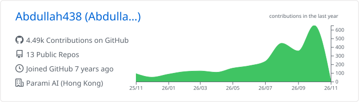
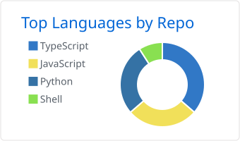
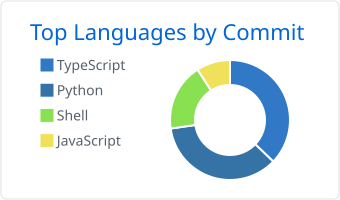

<h1 align="center">Hi, I'm Abdullah Khan 👋</h1>

  Full-stack developer at <b>Parami AI</b> · based in Pakistan 
  I build web apps, mobile apps, and Linux tools — lately with a lot of local AI in the loop.

  
  
  

---

### What I work on

- 🌐 **Web** — TypeScript, Next.js and React front ends on top of Node, Supabase and Postgres
- 📱 **Mobile** — Android (Kotlin/Java), Flutter and React Native, including BLE apps for IoT devices
- 🤖 **AI** — RAG pipelines, speech-to-text, and tools that run on local models with Ollama and whisper.cpp
- 🐧 **Linux** — shell tooling that makes a dev machine easy to set up, back up and rebuild

### Featured projects

| Project | What it is | Stack |
| --- | --- | --- |
| [**DevVault**](https://github.com/Abdullah438/dev-vault) | Zero-knowledge vault for API keys: secrets are encrypted in the browser (AES-256-GCM, Argon2id) before they reach the server | Next.js · Supabase · Web Crypto |
| [**whisper-dictate**](https://github.com/Abdullah438/whisper-dictate) | Offline speech dictation for Linux: speak, and the text is typed into the focused window | Python · whisper.cpp · PipeWire |
| [**keepsake**](https://github.com/Abdullah438/keepsake) | Snapshot your configs, packages and dev environment, then rebuild them after a reinstall | Bash · rsync · rclone |
| [**Scribe**](https://github.com/Abdullah438/scribe-ai) | Writing assistant with grammar checking and AI rewrites from a local model | Next.js · tRPC · Drizzle · Ollama |
| [**rag-app**](https://github.com/Abdullah438/rag-app) | Ask questions about your PDFs and get answers with source references | Python · Streamlit · LangChain |

### Tech stack

   
   
   
  

### GitHub activity

  <picture>
    <source media="(prefers-color-scheme: dark)" srcset="https://streak-stats.demolab.com?user=Abdullah438&theme=github-dark-blue&hide_border=true"/>
    
  </picture>

  <picture>
    <source media="(prefers-color-scheme: dark)" srcset="./profile-summary-card-output/github_dark/0-profile-details.svg"/>
    
  </picture>

  <picture>
    <source media="(prefers-color-scheme: dark)" srcset="./profile-summary-card-output/github_dark/1-repos-per-language.svg"/>
    
  </picture>
  <picture>
    <source media="(prefers-color-scheme: dark)" srcset="./profile-summary-card-output/github_dark/2-most-commit-language.svg"/>
    
  </picture>

  <picture>
    <source media="(prefers-color-scheme: dark)" srcset="https://raw.githubusercontent.com/Abdullah438/Abdullah438/output/github-snake-dark.svg"/>
    
  </picture>

### 💼 Hire me

I take freelance work through

and
,
or email me directly.
